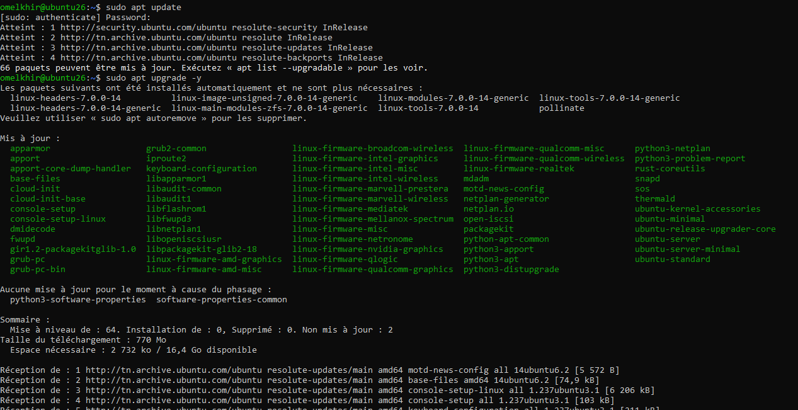
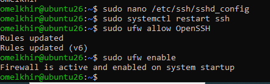

# Activité 1
## I. Mise en place initiale
### 1- Installez Ubuntu server 26.04 et configurez l'accès distant sécurisé via SSH.
 
 
 
 
### 2- Testez l'accès SSH à la VM à partir la machine physique.  

### 3- Installez docker sur la VM.  

### 4- Installez Jenkins en tant que service et vérifiez son bon fonctionnement à partir de la machine physique.  
 

### 5- Créez un mini CV One Page (HTML5/CSS3/Javascript) dans un dossier géré avec git et fournir son lien GitHub. 

### 6- Activer les push GitHub via SSH : Ouvrez GitHub / Settings → SSH and GPG keys / Cliquez sur New SSH key / Donnez un nom à la clé / Collez votre clé publique / Enregistrez / Tester: ssh -T git@github.com, Configurer le dépôt local pour utiliser SSH. 
